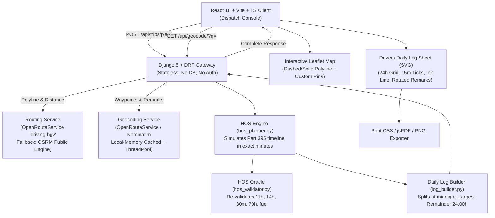

# ELD Trip Planner &mdash; FMCSA Hours of Service Dispatch Console

[](https://www.fmcsa.dot.gov/regulations/hours-of-service)
[]()
[]()
[]()

A full-stack logistics application engineered to simulate property-carrying commercial motor vehicle (CMV) trip dispatches under **FMCSA 49 CFR Part 395** Hours of Service (HOS) regulations. The app calculates routes, determines mandatory rest breaks, fuel stops, 10-hour sleeper berth rests, and 34-hour restarts, and draws authentic, pixel-perfect **Drivers Daily Log Sheets** replicating standard paper form RODS (`blank-paper-log.png`).

---

## Architecture Overview



---

## Fixed Regulatory Assumptions (FMCSA Part 395)

1. **Cycle Standard (§ 395.3(b)(2))**: Property-carrying commercial driver operating on a **70-hour / 8-day rolling cycle**.
2. **11-Hour Driving Limit (§ 395.3(a)(3)(i))**: May drive a maximum of 11 cumulative hours following 10 consecutive hours off duty.
3. **14-Hour Driving Window (§ 395.3(a)(2))**: May not drive after the 14th consecutive hour following the start of duty. Off-duty breaks do not extend the 14-hour window.
4. **30-Minute Rest Break (§ 395.3(a)(3)(ii))**: Mandatory $\ge 30$ consecutive minute break (off duty, sleeper berth, or on duty not driving) required within 8 cumulative hours of driving.
5. **Sleeper Berth Rest (§ 395.1(g)(1))**: 10 consecutive hours in the Sleeper Berth (`SB`) resets the 11-hour driving clock and 14-hour duty window.
6. **34-Hour Restart (§ 395.3(c))**: 34 consecutive hours off duty (`OFF`) resets cumulative cycle on-duty hours to 0. If `cycle_used_at_start >= 70`, trip begins with a 34-hour restart.
7. **Fueling Requirement**: Commercial vehicle refueling scheduled at least once every $\le 1,000$ miles (30 minutes On Duty).
8. **Terminal Operations**: 1.0 hour On Duty (not driving) for freight loading & inspection at pickup, and 1.0 hour On Duty at dropoff.
9. **Average Highway Speed**: Constant $V = 55.0\text{ mph}$ applied across route distance (configurable in settings).
10. **Time Base (§ 395.8(a)(1))**: All calculations and daily log sheets operate on the driver's **home terminal time** standard.

---

## Repository Structure

```
├── backend/
│   ├── config/
│   │   ├── settings.py       # Stateless Django settings (DATABASES = {}, DRF, CORS)
│   │   ├── urls.py           # Root URL routing
│   │   └── wsgi.py           # Production WSGI application
│   ├── trips/
│   │   ├── services/
│   │   │   ├── hos_planner.py    # Minute-based pure HOS simulation engine
│   │   │   ├── hos_validator.py  # Independent 7-rule compliance validator
│   │   │   ├── log_builder.py    # Midnight splitting & Largest Remainder 24.00h balancing
│   │   │   ├── routing.py        # ORS driving-hgv + OSRM routing with retry
│   │   │   ├── geocoding.py      # ORS + Nominatim cached geocoding & thread pool
│   │   │   └── geo_utils.py      # Haversine, cumulative miles, mile marker interpolation
│   │   ├── serializers.py    # Request validation (cycle 0-70, coordinates)
│   │   ├── views.py          # /api/trips/plan/, /api/geocode/, /api/health/
│   │   ├── urls.py
│   │   └── tests/
│   │       ├── test_planner.py   # FMCSR unit and property tests (100% pass)
│   │       ├── test_logs.py      # 24.00h exact balancing & multi-day log tests
│   │       ├── test_api.py       # API tests with mocked providers (200, 422, 502)
│   │       └── test_geo.py       # Geospatial & polyline unit tests
│   ├── api/index.py          # Vercel serverless WSGI entry point
│   ├── vercel.json           # Vercel deployment configuration
│   ├── manage.py
│   ├── pytest.ini
│   ├── requirements.txt
│   └── .env.example
├── frontend/
│   ├── src/
│   │   ├── api/client.ts     # Type-safe API client with timeout & error mapping
│   │   ├── components/       # Header, AssumptionsPanel, ErrorBanner, LoadingState, EmptyState
│   │   ├── features/
│   │   │   ├── form/         # TripForm, LocationInput (autocomplete & coords), ExampleTripButton
│   │   │   ├── map/          # RouteMap (Leaflet, custom markers, fitBounds, flyTo)
│   │   │   ├── summary/      # SummaryCards, HosGauges (11h/14h/70h), StopsTimeline
│   │   │   └── logs/         # LogSheet (SVG matching paper log), LogSheetViewer, PDF/PNG Exporters
│   │   ├── types/trip.ts     # TypeScript models
│   │   └── styles/index.css  # Tailwind tokens & print CSS
│   ├── package.json
│   ├── tailwind.config.js    # Slate-950 palette, fonts (Space Grotesk, JetBrains Mono, Caveat)
│   └── vite.config.ts
├── docs/reference/           # FMCSA Reference Guide & blank-paper-log.png
└── README.md
```

---

## Local Setup & Quick Start

### Prerequisites
- Python 3.12+ (tested on Python 3.14)
- Node.js 18+ (tested on Node v24)
- npm 9+

### 1. Backend Setup
```bash
cd backend

# Create virtual environment (optional)
python -m venv venv
# On Windows: venv\Scripts\activate
# On Linux/macOS: source venv/bin/activate

# Install dependencies
pip install -r requirements.txt

# Copy environment file
cp .env.example .env

# Run automated tests (all 17 test suites)
pytest

# Start stateless Django development server
python manage.py runserver 127.0.0.1:8000
```
Backend health check is accessible at `http://127.0.0.1:8000/api/health/`.

### 2. Frontend Setup
```bash
cd frontend

# Install dependencies
npm install

# Copy environment file
cp .env.example .env

# Verify production build
npm run build

# Start Vite client
npm run dev
```
Open `http://localhost:5173/` in your browser.

---

## Running the Automated Test Suite

All 17 tests verify regulatory correctness without requiring external API keys:

```bash
cd backend
pytest -v
```

### Test Coverage Highlights:
1. `test_short_trip_no_break_no_rest`: Validates short trip (<8h driving) has 0 rests, 0 breaks, and mandatory 1h pickup & dropoff.
2. `test_700_mile_trip_break_and_rest`: Validates 30-min break by hour 8 of driving and 10-h rest after $\le 11$h driving.
3. `test_2300_mile_trip_fuel_and_multiple_days`: Validates fueling stops with no gap exceeding 1,000 miles across multi-day shifts.
4. `test_cycle_used_65_triggers_restart_when_70_hit`: Validates 34-hour restart inserted when 70 hours is reached.
5. `test_cycle_used_70_starts_with_restart`: Validates trip begins with a 34h restart if cycle is exhausted at dispatch.
6. `test_randomized_property_routes_hos_valid`: Property test generating 25 randomized route distances and cycle values; verifies `validate_hos()` returns 0 violations on 100% of plans.
7. `test_daily_logs_every_day_sums_to_24_and_miles_match`: Verifies that every generated daily log sheet sums to **EXACTLY 24.00 hours** using the Largest Remainder algorithm and mileage matches driving segment sums.
8. `test_api_*`: End-to-end integration tests for happy path, 422 validation errors, and 502 provider failure resilience.

---

## API Documentation

### `POST /api/trips/plan/`
Dispatches a complete HOS trip plan.

#### Request Body
```json
{
  "current_location": { "label": "Chicago, IL, USA", "lat": 41.8781, "lng": -87.6298 },
  "pickup_location": { "label": "Dallas, TX, USA", "lat": 32.7767, "lng": -96.7970 },
  "dropoff_location": { "label": "Atlanta, GA, USA", "lat": 33.7490, "lng": -84.3880 },
  "cycle_used_hours": 40.0,
  "start_datetime": "2026-10-05T08:00:00",
  "carrier_name": "Antigravity Freight Lines",
  "vehicle_numbers": "TRK-9042 / TRL-4410",
  "driver_name": "Alex Vance"
}
```

#### Response (`200 OK`)
```json
{
  "summary": {
    "total_miles": 1749.6,
    "driving_hours": 31.81,
    "trip_duration_hours": 76.5,
    "days": 5,
    "fuel_stops": 1,
    "rests": 3,
    "restarts": 1,
    "hos_valid": true,
    "violations": []
  },
  "route": {
    "geometry": [[41.8781, -87.6298], "..."],
    "legs": [
      { "from": "Chicago, IL", "to": "Dallas, TX", "miles": 922.4, "hours": 16.77 },
      { "from": "Dallas, TX", "to": "Atlanta, GA", "miles": 827.2, "hours": 15.04 }
    ]
  },
  "stops": [
    {
      "id": "stop-1",
      "type": "origin",
      "label": "Origin: Chicago, IL",
      "location": { "label": "Chicago, IL", "lat": 41.8781, "lng": -87.6298 },
      "arrive": "2026-10-05T08:00:00",
      "depart": "2026-10-05T08:00:00",
      "duration_minutes": 0,
      "mile_marker": 0.0,
      "note": "Trip dispatch & departure point"
    }
  ],
  "daily_logs": [
    {
      "date": "2026-10-05",
      "total_miles": 605.0,
      "hours": { "off": 8.5, "sb": 4.5, "driving": 11.0, "on_duty": 0.0 },
      "segments": ["..."],
      "remarks": [{ "time": "08:00", "location": "Chicago, IL", "note": "Driving" }],
      "recap": { "on_duty_today": 11.0, "line_a": 51.0, "line_b": 19.0, "line_c": 11.0 },
      "header": { "carrier_name": "Antigravity Freight Lines", "driver_name": "Alex Vance" }
    }
  ],
  "assumptions": ["..."]
}
```

### `GET /api/geocode/?q={search_query}`
Debounced address autocomplete with coordinate lookup support.

### `GET /api/health/`
Cold-start liveness verification endpoint.

---

## Daily Log Sheet SVG Architecture

The log sheet is rendered as a vector SVG strictly replicating the layout of `docs/reference/blank-paper-log.png`:
- **Paper Aesthetics**: Clean `#fcfcf9` card with subtle border and paper shadow on dark console background.
- **24-Hour Graph Grid**: 4 duty rows with 15-minute resolution ticks (full-height at hour, medium at 30 min, quarter at 15/45 min).
- **Ink Line Drawing**: Thick royal blue ink line (`#1d4ed8`, 3.2px stroke, round caps/joins) tracing continuous duty segments and vertical step transitions between rows.
- **Angled Remarks**: Rotated city/state remarks (-58 degrees) connected to duty change tick marks under the grid.
- **Recap Block**: Automatically completes 70hr/8day driver calculations (Line A: total hours on duty in 8-day window; Line B: hours available tomorrow; Line C: total on duty last 5 days).
- **Export Options**:
  - **Print**: Formatted with `@media print` CSS for 1 sheet per Letter landscape page.
  - **PDF Export**: Single-click high-resolution PDF download using `jsPDF`.
  - **PNG Export**: Crisp PNG rasterization using `html2canvas`.
  - **Download All**: Compiles every day's sheet into a consolidated multi-page PDF document.

---

## Deployment Instructions

### Vercel Deployment (Full-Stack Monorepo)
1. Fork or clone this repository.
2. In Vercel, import the project.
3. Configure Environment Variables:
   - `ORS_API_KEY`: *(Optional)* OpenRouteService API key for HGV routing (OSRM is used as default fallback).
   - `DJANGO_SECRET_KEY`: Secure random string.
   - `DEBUG`: `False`.
   - `ALLOWED_HOSTS`: `.vercel.app`.
   - `VITE_API_BASE_URL`: Production backend URL (or left empty for relative API proxy).
4. Deploy! The root `vercel.json` and `backend/api/index.py` handle serverless WSGI execution with 60s execution timeout.

---

## Assessment Deliverables Checklist

- [x] **Stateless Backend**: Python 3.14 + Django 5 + DRF, `DATABASES = {}`, no sessions, no auth models.
- [x] **HOS Engine (`hos_planner.py`)**: Pure simulation engine implementing 11h driving, 14h window, 30m break, 10h rest, 34h restart, fuel stops $\le 1,000$ mi.
- [x] **HOS Validator (`hos_validator.py`)**: Independent 7-rule compliance oracle returning `hos_valid: true`.
- [x] **Daily Log Builder (`log_builder.py`)**: Largest-Remainder 24.00h balancing, midnight slicing, and recap calculations.
- [x] **Paper Log Sheet SVG (`LogSheet.tsx`)**: Pixel-perfect vector replication of `blank-paper-log.png` with handwriting font, `#1d4ed8` ink line, and PDF/PNG export.
- [x] **Modern UI/UX**: Slate-950 dark console, Leaflet map with custom stop markers, HOS gauges, stops timeline, and "Try Example Trip" button.
- [x] **Test Suite**: 17 automated tests passing in pytest (unit, property, log balancing, API mocks).
- [x] **Resilience**: Server-side fallback from OpenRouteService to OSRM and Nominatim with in-memory caching.
